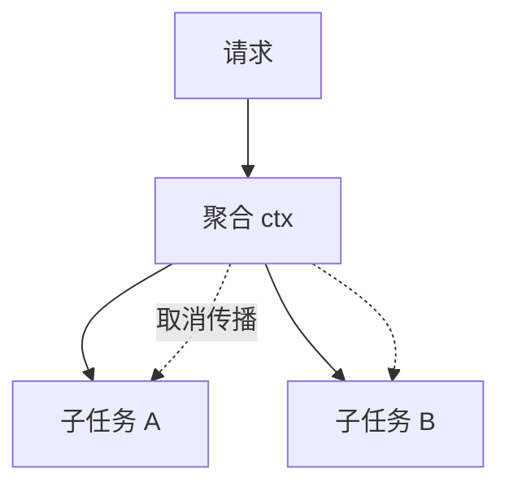

# kb-article-writing · MUYI 知识库文章写作

## 何时使用

- 用户要求在 MUYI 仓更新/新增知识文章（"今天更新3篇GO语言的知识内容"）
- 自测清单出现 🕰 缺口要补文（`自测清单.md` 是官方待补清单）
- 某技术栈新上手，要按既有系列体例开新轨或续写

**与姊妹技能的分工**：本技能管**写新篇**（选题→成文→入库）；存量内容的体检/死链/规整走 `kb-upkeep`；全库治理闭环（规整/复核/复审）走 `kb-governance`。写作过程中发现存量问题的，记录后移交对应技能处理，不顺手改（一篇一 commit 纪律）。

## 全流程六步

### Step 1 盘点：先看库里有什么，再决定写什么

```bash
cd ~/Documents/GitHub/MUYI
ls "A-后端内核/"            # 轨道目录：A-后端内核/B-AI工程/C-架构/D-云原生/E-算法/F-前端/G-业务领域
ls "A-后端内核/go/"         # 目标轨道已有篇目
grep -c "====" <已有篇>.md  # 每篇标题结构
python3 scripts/audit.py "A-后端内核/go"   # 治理特征：字数/来源(转载系vs反哺系)/互链/死链
```

必读：目标轨道**至少完整读一篇**（格式模板全在里面）；`自测清单.md` 里对应领域的 🕰 行是选题的官方依据。

### Step 2 选题三原则

1. **补缺不重复**：新篇与已有篇零重叠，且第一段就声明在系列中的位置（"开篇点到为止，本篇展开"）；
2. **受众校准**：系列是"从X视角看Y"体（从Java视角看Go/Python）——受众是**十年老兵新学新语言**，不是零基础。每个概念先给旧语言锚点（Java 对应物）再讲差异；
3. **实战出血点优先**：刚在生产踩过的坑 > 教科书目录。用户最近在用什么技术，就写该技术"第一周会出血的地方"。

### Step 3 成文：套系列格式模板（下节），四件套缺一不可

对照表（Java↔新语言逐项映射）、代码块（中文注释标关键行）、面试追问链、面试官视角小结。涉及多方交互/流转的内容**配 Mermaid 图**（见下节）。

### Step 4 侧栏：走生成链，绝不手改

```bash
cd book/
node scripts/prepare-src.mjs        # 复制书源副本（gitignore）+ HTML→MD 预处理 + 敏感词断言
node .vitepress/build-sidebar.mjs   # 从各篇 H1 生成 sidebar.json（gitignore 生成物）
```

`sidebar.json` 与 `book/src`、`book/dist` 都是 gitignored 生成物——手改会被下次生成覆盖且进不了库。

### Step 5 构建验证

```bash
cd book/ && npx vitepress build     # ~77s/383 篇；全量渲染通过才算完
```

### Step 6 提交：源文件 only，master 分支

```bash
cd ~/Documents/GitHub/MUYI
git add "A-后端内核/go/<新篇>.md"   # 只加源 md；生成物已被 gitignore 挡住（强行加会被拒）
git commit -m "知识更新: <轨道>第N篇——<主题>（<受众视角>）"
git push origin master              # ⚠️ MUYI 是 master 不是 main（push main 会报 refspec 错）
```

铁律（book/计划.md）：**一篇一 commit**——书源是仓库 markdown 原文，一次干净的 commit 就是书的"版本"。

## 文章格式模板（系列体例，直接套）

```markdown
<标题：从X视角看Y-子主题>
====

<开篇 2-3 句：承接系列前篇（互链）+ 本篇解决什么实战问题 + 一句话点破"旧语言直觉的根本错位">

1 <节标题：动宾结构>
------

**<旧语言直觉>**：...
**<新语言现实>**：...

<代码块/对照表/推论列表>

<...2-5 节，每节先锚点后差异>

<N> 与 Java <对应体系>总对照
------

| 新语言 | Java 对应 | 关键差异 |
|---|---|---|

面试追问链
------

* <问题>？→ <一句话答案>；<追问>？→ <答案>     （6-8 条，覆盖全篇要点）

面试官视角小结
------

<一段：什么样的表现算"写过生产代码"，什么是"没下场的信号"——给区分度判据>

> 2026-XX 新增（<轨道>第 N 篇）。姊妹篇：[<篇名>](./<文件名>.md)、[<篇名>](./<文件名>.md)。
```

格式要点：
- H1 用 `====` 下划线式，H2 用 `N 标题` + `------` 下划线式（侧栏生成器两种都认）；
- **`====` 只留给文章首标题，小节一律 h2（`----` 或 `##`）**——书站 outline 只收
  h2/h3，小节写 h1 会让右侧"On this page"空白（2026-11-06 全库清零 176 篇、
  降级 758 个小节标题，commit 0741cd6；fixer 教训：首标题判定必须同时识别
  setext1/setext2/ATX 三种形态，只认 ==== 会把"看在前面(----)+小节(====)"
  结构的小节误当首标题保留）；
- **首标题必须是真标题**（与文件名一致的篇文章题）——泛用小节名（看在前面/前言/文章清单/
  Question）只能做 H2。侧栏条目与页 H1 都取首个标题，泛用名当首标题会让导航与内容割裂
  （2026-11-04 修复存量 116 篇，批量修法见当次 commit c0950ca）；
- **无外链图片**（库规约）：示意图用 ASCII/表格表达，不引 ``；
- **footer 的 `> 2026-XX 新增（…）` 是反哺系标记**——`scripts/audit.py` 靠它区分"生产反哺文"与"转载整理文"，别省；
- 文内互链用相对路径（同轨 `./x.md`，跨轨 `../../D-云原生/...`），audit.py 会盘互链与死链。

## 画图能力：Mermaid（文本即图，2026-11-04 引入）

选型结论：**Mermaid**（MIT 开源）——图是 ```` ```mermaid ```` 代码块，不是图片文件：
书站渲染成 SVG（book 已配 vitepress-plugin-mermaid + mermaid 11），GitHub 仓页原生渲染
同一份代码块——**一处写两侧看，git 可 diff，库内零二进制新增**（与"无外链图片"库规约天然兼容）。

**图型选择**（技术文档 90% 落在前三）：

| 图型 | 适用 | 典型场景 |
|---|---|---|
| `flowchart TD/LR` | 链路/架构/树形传播 | 调用链、组件关系、ctx 取消树、数据流 |
| `sequenceDiagram` | 跨参与方时序 | RPC 交互、协议握手、锁的争抢时序 |
| `stateDiagram-v2` | 状态机 | 错误状态流转、订单/任务生命周期 |
| `classDiagram` | 类型关系 | 继承/组合结构（Java 对照文常用） |

**用图时机**：参与方 ≥3 且文字要读两遍才能脑补的关系，必须配图（如 channel 语义矩阵的
流转、GMP 调度）；一两个元素的行内关系仍用 ASCII/表格——**轻量优先，图不为装饰**。

**语法易错**：节点文本含括号/冒号必须引号包裹 `A["带(括号)的文本"]`；换行用 `<br/>`；
高亮 `style X fill:#fde8e8`；`-.->` 虚线箭头表示广播/传播类弱关系。



改动 mermaid 块后走 Step 4/5 全链构建（prepare-src 对代码块透传，无需特殊处理）。

## 写作心法（比格式更值钱的三条）

1. **锚点先行**：每个新概念第一句话先给 Java 对应物（"channel 最接近的比喻是 SynchronousQueue + 关闭语义"），老兵的已有知识是 fastest path；
2. **纠错直觉 > 罗列语法**：每篇开头点破一个根本错位（"Go 赋值拷贝的是字面值，不是引用"），后面所有"陷阱"都是这条规则的推论——比背十个特例值钱；
3. **面试导向是这本书的灵魂**：追问链写"深度边界"（能被连环追问三层的位置），面试官小结写"区分度判据"（什么表现算下过场）——这是全书区别于普通教程的定位。

## 陷阱表（2026-11-04 实战实证）

| 陷阱 | 症状 | 解法 |
|---|---|---|
| 手改 sidebar.json | 改了不生效/进不了库 | 走 Step 4 生成链（gitignored 生成物） |
| 生成器吞代码块注释 | 侧栏标题显示 Dockerfile 注释等怪文案 | build-sidebar.mjs 已修（剥离 ``` 围栏 + 兼容 setext）；复现先查 titleOf |
| push origin main | `src refspec main does not match any` | MUYI 是 master；push 前看 `git branch --show-current` |
| git add 生成物 | `paths are ignored` 报错 | 只加源 md；sidebar.json/dist/src 本就该忽略 |
| 中文文件名八进制 | git status 显示 `\346\226...` 难对齐 | 正常现象，按引号路径 add 即可 |
| 裸 HTML/尖括号 | 书里被转义显示 | 仓库 config `markdown.html=false`（防 `<init>` 吞字）；泛型/标签写进代码块 |
| 敏感词断言失败 | prepare-src 中断 | 按断言输出定位改源文（断言是发布前闸门） |
| **serve 不重启假死** | 重建后点击侧栏/搜索全无反应、内容还能看 | `vitepress serve` 启动时对 dist 建文件快照（sirv），重建换哈希名后新 JS 全 404→水合失败；**每次 rebuild 后必须重启 serve**。诊断特征：`performance` 资源里 `app.*.js: 404` |

## 实战存档

- **2026-11-04 Go 轨第 4-6 篇**（并发三件套/错误处理/slice与map值语义）：三篇全部瞄准"十年 Java 新上 Go 第一周出血点"；过程中发现并修复 build-sidebar.mjs 代码块注释当 H1 的生成器 bug（Go上手实战侧栏错文案存因数月）——**写文章时顺手审计流水线本身**，是这个库的隐藏收益。
